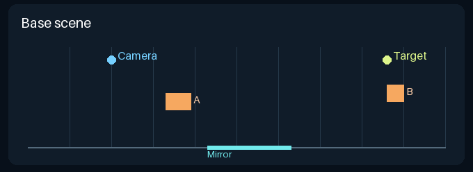
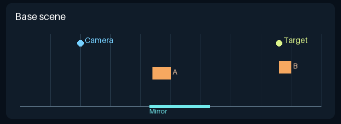

# The Missing Scratch

**Can a vision model tell when moving one obstacle leaves a camera target uninspected?**

The Missing Scratch is an Innodata Track 2 benchmark for reflected camera coverage. A seeded generator produces top-down images, questions, and reference answers for three inspection decisions. Each matched pair changes one element of the layout and flips the correct answer.

**200 scenes · 100 matched pairs · 3 task types · 2 geometry methods**

[Run the demo](#quick-start) · [Pilot results](#pilot-results) · [Frozen dataset](datasets/v4/cases.json) · [Validation evidence](#evidence-and-results)

## Problem statement

A camera can have a mirror in view while the target's reflected path is blocked. A false coverage answer could lead an inspector to mark a hidden target as checked. The benchmark asks models to determine whether the target is visible, identify the first obstruction along the reflected route, or choose the change that restores coverage.

## Example pair

| Obstacle in the reflected path | Obstacle moved clear of the path |
| --- | --- |
|  |  |
| **0000-0 · Blocked** | **0000-1 · Visible** |

The camera, target, and mirror stay fixed. Obstacle A changes position. The diagrams are the exact images shipped in the benchmark.

## Quick start

Clone the repository, then run these commands from its root. The release check requires Python 3.12 or later and uses the standard library. The Docker demo requires Docker Compose.

```sh
python3 -m scratch.verify_release
docker compose up --build
```

Start with the [opening benchmark pair](http://127.0.0.1:8000/#simulator/benchmark/0000-0). Lock a prediction for each scene, reveal the geometry, and compare your answers with the recorded model replies. Open [the case gallery](http://127.0.0.1:8000/#simulator) for obstruction and repair cases, or [Evidence](http://127.0.0.1:8000/#evidence) for the validation records.

For generation and tests without Docker:

```sh
python3 -m venv .venv
.venv/bin/python -m pip install -r requirements.txt
make test
make build
```

For fresh V3 tasks, open [Live inspection](http://127.0.0.1:8000/#live). The integrated service locks predictions on the server and exposes the verified diagram after reveal. See [backend setup](docs/LIVE-BACKEND.md).
## Build a custom inspection setup

Open the [setup builder](http://127.0.0.1:8000/#simulator/sandbox). The warehouse preset starts with a rack blocking the incoming ray. Choose **Save baseline**, then **Apply verified repair** to compare the blocked and visible layouts. Drag equipment or set its X and Y coordinates. With the scene focused, the arrow keys move the selected item one plan unit, or ten with Shift.

Custom layouts support one camera, one target, one horizontal mirror, and multiple rectangular blockers. Save layouts in the current browser or export a versioned JSON file to share. The builder evaluates the plan-view sightline. The orbit view illustrates that geometry, and custom layouts do not affect frozen benchmark scores.

## How the pipeline works

| Stage | Entry point | Output |
| --- | --- | --- |
| Generate | `python -m scratch.build --seed 42 --pairs 100` | PNGs, questions, choices, geometry traces, and reference answers |
| Check geometry | `scratch/geometry.py` | Exact-fraction virtual-target and equal-slope calculations, with separate occlusion checks |
| Verify release | `python3 -m scratch.verify_release` | Checks image hashes, pair structure, and evidence binding against the shipped manifest |
| Reproduce | `python3 -m scratch.reproduce datasets/v4 --revision ab5b79d` | Clean Linux ARM64 Docker comparison of the manifest and all 200 images |
| Evaluate | `python -m scratch.evaluate` | Per-case responses in vision or question-only mode |
| Report | `python -m scratch.publish_reports` | Run summaries, task and difficulty breakdowns, strict pair accuracy, and paired error examples |

The frozen release has **68 visibility, 66 obstruction, and 66 repair cases**. Both members of a pair must be correct to earn pair credit.

## Pilot results

Both systems saw the same two frozen cases, with and without the scene images. A strict pair earns one point only when both answers are correct. GPT-6 Luna was run through Codex CLI.

| Model | With image | Question only | Strict pair with image | Strict pair with question only |
| --- | ---: | ---: | ---: | ---: |
| GPT-6 Luna (`gpt-6-luna`) | 2/2 | 1/2 | 1/1 | 0/1 |
| Gemini 3 Flash Preview (`gemini-3-flash-preview`) | 1/2 | 0/2 | 0/1 | 0/1 |

Gemini called both scenes **Blocked**, missing the clear scene. In an inspection, that could trigger an unnecessary repeat check. The finding covers one pair. The pilot record also includes a separate GPT-6 Luna obstruction pair. [Exact images, answers, and shortcut checks](evidence/PILOT-FINDING.md) · [Recorded replies](site/lab-pilot.json)

The full 200-scene model evaluation is pending. Complete runs will be published with per-task, per-difficulty, and strict pair scores.

## Evidence and results

| Evidence | Status | Inspect |
| --- | --- | --- |
| Frozen dataset | 200 images and 100 pairs checked | [Manifest](datasets/v4/cases.json) · [Images](datasets/v4/images) |
| Clean rebuild | Manifest and all 200 images matched byte for byte on Linux ARM64 | [Rebuild record](site/reproduction.json) |
| Shortcut audit | Measured on held-out layouts. Visibility position rules scored 34/68. Camera-side-only scored 38/66 on obstruction and 36/66 on repair. | [Audit output](datasets/v4/validity-audit.json) |
| Blind human review | Exact inputs verified for the 72-case packet. Independent agreement pending. | [Review protocol](evidence/RUNBOOK.md#collect-the-evidence) |
| Frontier model comparison | Opening pair recorded in both modes. Full runs pending. | [Published aggregates](site/model-reports.json) · [API setup](docs/API-SETUP.md) |
| Physical camera check | Opening-pair protocol ready. Physical frames pending. | [Demo protocol](evidence/DEMO.md) |

The synthetic geometry assumes a single finite specular mirror, a point camera and target, and opaque obstacles in a top-down plane. Difficulty labels are generator settings. The shortcut audit covers specific simple features. Blind review will test whether people can interpret the diagrams as intended.

## Documentation

[Evidence runbook](evidence/RUNBOOK.md) · [System card](evidence/SYSTEM.md) · [Judging checklist](evidence/JUDGING.md) · [Product requirements](docs/PRD.md) · [Technical design](docs/TRD.md) · [Development lifecycle](docs/SDLC.md)

The public playground reveals reference answers. Use the separate blind packet for human review. Keep provider keys, raw review files, and the coordinator key outside the public repo. Model icons are from [Lobe Icons](https://github.com/lobehub/lobe-icons).
